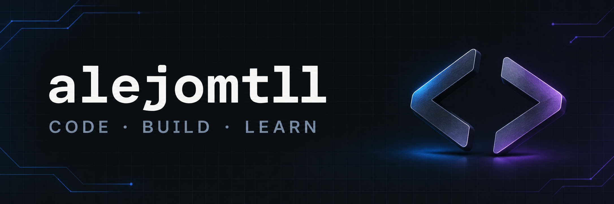

<!--
CONFIGURACIÓN
1. Reemplaza TU-USUARIO-GITHUB por tu usuario real en todo el documento.
2. Sustituye los datos personales y los enlaces de redes sociales.
3. El stack y la frase utilizan los ejemplos de tu solicitud.
4. Guarda este README.md en tu repositorio público TU-USUARIO-GITHUB.
5. Los widgets dependen de servicios externos y requieren un usuario válido.

LIMITACIONES DEL RENDERIZADO
GitHub controla los bordes de las tablas y elimina los estilos CSS personalizados.
La altura exacta del GIF depende de sus proporciones y del ancho de pantalla.
Para esquinas redondeadas fiables, incorpóralas directamente en las imágenes.
-->

<!-- 01 · HERO -->

<div align="center">
  <a href="https://github.com/TU-USUARIO-GITHUB">
    
  </a>
</div>

<br />

<!-- 02 · ABOUT ME -->

<h2 align="center">👨‍💻 About Me</h2>

<table width="100%" border="0" cellspacing="0" cellpadding="0">
<tr>
<td width="60%" valign="top">

```js
const developer = {
  name: "Tu Nombre",
  username: "TU-USUARIO-GITHUB",
  role: [
    "Engineering Student",
    "Full-Stack & Desktop Developer"
  ],
  location: "Tu Ciudad, País",
  building: [
    "Desktop Apps with Tauri",
    "Web Platforms"
  ],
  learning: [
    "System Design",
    "Docker",
    "Database Architecture"
  ],
  stack: {
    languages: [
      "Java", "Python", "JavaScript",
      "TypeScript", "Rust"
    ],
    frontend: [
      "HTML", "CSS", "Tailwind CSS"
    ],
    desktop: ["Tauri"],
    databases: ["MySQL", "SQL Server"],
    tools: [
      "Docker", "Git", "GitHub",
      "Figma", "WordPress"
    ]
  }
};
```

> *“First, solve the problem. Then, write the code.”*

<p align="right"><em>— John Johnson</em></p>

</td>
<td width="40%" valign="middle" align="center">
  
</td>
</tr>
</table>

<br />

<!-- 03 · CONNECT WITH ME -->

<h2 align="center">🌐 Connect With Me</h2>

<p align="center">
  <a href="https://www.linkedin.com/in/TU-USUARIO-LINKEDIN/">
    
  </a>
  <a href="https://x.com/TU_USUARIO_X">
    
  </a>
  <a href="https://www.instagram.com/TU_USUARIO_INSTAGRAM/">
    
  </a>
  <a href="https://discord.com/users/TU_ID_DISCORD">
    
  </a>
  <a href="mailto:tu.correo@example.com">
    
  </a>
</p>

<!-- Opcional: descomenta este bloque y sustituye la URL.
<p align="center">
  <a href="https://tu-dominio.example">
    
  </a>
</p>
-->

<br />

<!-- 04 · TECH STACK -->

<h2 align="center">⚡ Tech Stack</h2>

<p align="center">
  <a href="https://skillicons.dev">
    
  </a>
</p>

<h4 align="center">Tools · Libraries · Environments</h4>

<p align="center">
  
  
  
  
</p>

<p align="center">
  
  
  
  
</p>

<p align="center">
  
  
  
</p>

<br />

<!-- 05 · GITHUB ANALYTICS -->

<h2 align="center">📊 GitHub Analytics</h2>

<div align="center">
  <a href="https://github.com/TU-USUARIO-GITHUB">
    
  </a>
</div>

<table width="100%" border="0" cellspacing="0" cellpadding="0">
<tr>
<td width="50%" align="center" valign="top">
  
</td>
<td width="50%" align="center" valign="top">
  <!-- utcOffset=0 representa UTC; ajústalo a tu zona horaria. -->
  
</td>
</tr>
<tr>
<td width="50%" align="center" valign="top">
  
</td>
<td width="50%" align="center" valign="top">
  
</td>
</tr>
</table>

<br />

<!-- 06 · GITHUB TROPHIES -->

<h2 align="center">🏆 GitHub Trophies</h2>

<div align="center">
  <a href="https://github.com/ryo-ma/github-profile-trophy">
    
  </a>
</div>

<!-- banner.png: súbelo a la raíz; recomendado 1600 × 400 px, fondo oscuro y acentos azul/violeta. -->
<!-- coding.gif: súbelo a la raíz; recomendado vertical, aproximadamente 600 × 1000 px, con un setup nocturno. -->
<!-- No necesitas más imágenes locales: los iconos, badges, estadísticas y trofeos se cargan mediante sus URLs. -->
